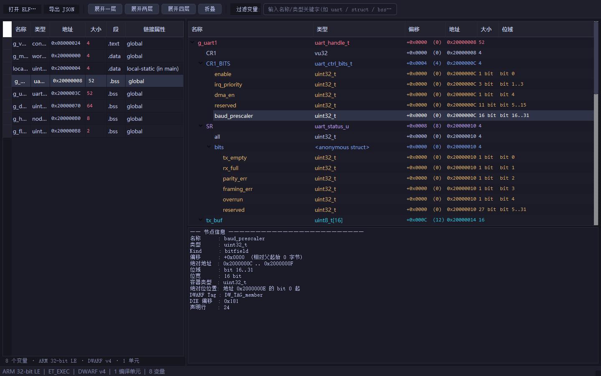
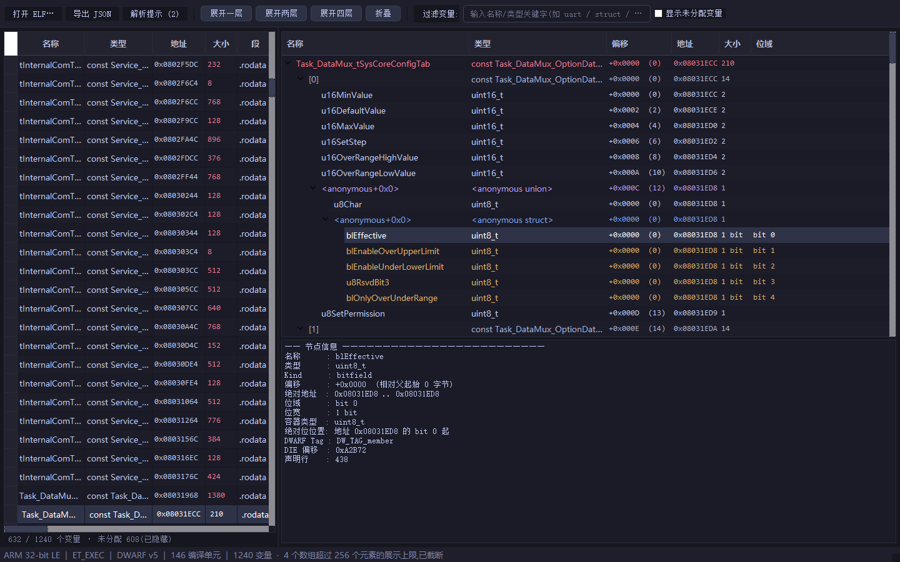

# ELF Variable Explorer

一个用于解析ARM IDE STM32CubeIDE，KEIL，IAR编译生成的**ELF / AXF / OUT**文件的桌面工具，把变量还原成可展开的类型树，展示每个成员的**类型、地址、偏移、大小和位域信息**。

**注：该工程完全由Vibe Coding完成，包括本README.md文件（除此行外）**



---

## 目录

- [功能特性](#功能特性)
- [支持的格式与编译器](#支持的格式与编译器)
- [快速开始](#快速开始)
- [使用说明](#使用说明)
- [树节点字段说明](#树节点字段说明)
- [工作原理](#工作原理)
- [兼容性验证](#兼容性验证)
- [项目结构](#项目结构)
- [命令行工具](#命令行工具)
- [已知限制](#已知限制)
- [常见问题](#常见问题)
- [Roadmap](#roadmap)
- [开发与测试](#开发与测试)
- [依赖与致谢](#依赖与致谢)

---

## 功能特性

### 变量与类型解析

- 全局变量、文件内 `static` 变量、函数内 `static` 变量
- `struct` / `union` / 嵌套结构体 / 匿名结构体
- 一维与多维数组，逐元素展开并计算每个元素的地址
- 枚举类型及枚举成员值
- 指针（显示目标类型，不递归解引用）
- `typedef` 类型链
- `const` / `volatile` 限定符

### 布局信息

每个变量和成员都可以看到：

| 信息 | 说明 |
| --- | --- |
| 类型 | 完整的 C 类型字符串，保留 typedef 名称 |
| 地址 | 绝对地址，如 `0x20000008` |
| 偏移 | 相对父结构体/数组起始位置的字节偏移 |
| 大小 | 该对象占用的字节数 |
| 所在段 | `.data` / `.bss` / `.rodata` / `ER_IROM1` 等 |
| 链接属性 | `global` / `static` / `local-static` |
| 位域 | 起始位、位宽、位范围、存储容器类型 |
| 来源 | 所属编译单元（CU），用于区分不同文件中的同名 `static` 变量 |
| DWARF | 对应 DIE 的 tag 与 offset，便于追溯 |

### 位域支持

- 现代编码 `DW_AT_data_bit_offset`（GCC / Clang / ARM Compiler 6）
- 传统编码 `DW_AT_bit_offset` + `DW_AT_byte_size`（IAR、旧版 ARM Compiler）
- 自动换算为**相对父结构体的绝对位偏移**，并给出 `bit 3..7` 形式的范围
- 同时显示位域所在的存储单元类型（如 `uint32_t`）

### 界面能力

- 左侧变量列表 + 右侧无限层级类型树
- 按变量名、类型、所在段、编译单元即时过滤
- 一键展开 1 / 2 / 4 层，或全部折叠
- 节点详情面板：完整类型、地址区间、位域、typedef 链、枚举值、DWARF 属性
- 右键复制变量名、类型字符串、地址
- 深色主题，高 DPI 适配
- 解析在后台线程执行，不阻塞界面
- 导出完整变量树为 JSON

---

## 支持的格式与编译器

| 工具链 | 典型文件 | DWARF | 地址形式 | 位域编码 |
| --- | --- | --- | --- | --- |
| STM32CubeIDE (GCC) | `.elf` | v2 – v5 | `DW_OP_addr` / `.debug_loclists` | `data_bit_offset` 为主 |
| IAR Embedded Workbench | `.out` / `.elf` | v2 – v4 | `.debug_loc`（loclistptr） | `bit_offset` |
| KEIL MDK (ARMCC / AC6) | `.axf` / `.elf` | v2 – v4 | `.debug_loc`（loclistptr） | `bit_offset` |
| 通用 GCC / Clang | `.elf` / `.o` | v2 – v5 | `DW_OP_addr` / `DW_OP_addrx` | 两种均支持 |

> 文件扩展名只是习惯，本质都是 ELF。工具按 ELF 头和节内容识别，不依赖扩展名。

---

## 快速开始

### 环境要求

- Python **3.10+**
- Windows / Linux / macOS（界面基于 Qt 5，均可运行）

### 安装

```bash
git clone <your-repo-url>
cd <repo-dir>

python -m venv .venv
# Windows
.venv\Scripts\activate
# Linux / macOS
# source .venv/bin/activate

pip install -r requirements.txt
```

### 运行

```bash
# 直接打开文件
python main.py path/to/firmware.elf

# 或者启动后通过「打开 ELF…」选择
python main.py
```

也可以直接打开仓库自带的测试文件：

```bash
python main.py samples/demo.elf
```

`samples/demo.elf` 是一个 Cortex-M4 风格的测试镜像，覆盖结构体、位域、联合体、数组、枚举、指针和函数内静态变量。

---

## 使用说明

### 基本流程

1. `Ctrl+O` 或点击「打开 ELF…」
2. 选择 `.elf` / `.axf` / `.out` / `.o` 文件
3. 在左侧列表中选择变量
4. 在右侧树中展开结构体、联合体、数组
5. 选中任意成员，在下方查看类型、地址、偏移、位域等详情

### 快捷键

| 快捷键 | 功能 |
| --- | --- |
| `Ctrl+O` | 打开 ELF 文件 |
| `Ctrl+E` | 导出当前解析结果为 JSON |
| 右键变量 | 复制变量名 / 复制地址 / 在树中查看 |
| 右键树节点 | 复制名称 / 复制类型 / 复制地址 |

### 关于「未分配变量」

某些变量在头文件中声明、但从未被引用，链接阶段被丢弃。GCC 仍会在 DWARF 中保留其声明，此时 `DW_OP_addr` 为 `0`，且不属于任何有效段。

这类变量会被标记为**未分配**：

- 默认不显示，避免结构体成员地址全部变成 `0x0` 造成误判
- 勾选「显示未分配变量」后可以查看，同时会显示判定原因
- 顶栏「解析提示」中可以查看本次解析的统计与警告

---

## 树节点字段说明

右侧类型树包含六列：

```text
名称 | 类型 | 偏移 | 地址 | 大小 | 位域
```

示例（`g_uart1`）：

```text
g_uart1                uart_handle_t          +0x00  0x20000008  52  -
├─ CR1                 vu32                   +0x00  0x20000008   4  -
├─ CR1_BITS            uart_ctrl_bits_t       +0x04  0x2000000C   4  -
│  ├─ enable           uint32_t               +0x00  0x2000000C   4  bit 0
│  ├─ irq_priority     uint32_t               +0x00  0x2000000C   4  bit 1..3
│  ├─ dma_en           uint32_t               +0x00  0x2000000C   4  bit 4
│  ├─ reserved         uint32_t               +0x00  0x2000000C   4  bit 5..15
│  └─ baud_prescaler   uint32_t               +0x00  0x2000000C   4  bit 16..31
├─ SR                  uart_status_u          +0x08  0x20000010   4  -
│  ├─ all              uint32_t               +0x00  0x20000010   4  -
│  └─ bits             <anonymous struct>     +0x00  0x20000010   4  -
│     ├─ tx_empty      uint32_t               +0x00  0x20000010   4  bit 0
│     └─ ...
├─ tx_buf              uint8_t[16]            +0x0C  0x20000014  16  -
│  ├─ [0]              uint8_t                +0x00  0x20000014   1  -
│  ├─ [1]              uint8_t                +0x01  0x20000015   1  -
│  └─ ...
└─ next                uart_handle_t *        +0x30  0x20000038   4  -
```

要点：

- **偏移**始终相对直接父节点：位域相对所在结构体，数组元素相对数组起始
- **地址**已经累加为绝对地址；指针目标不计算地址（`-`）
- **大小**对数组是总大小，对位域是存储容器大小
- 联合体成员的偏移全部为 `0`，地址相同，这是正确行为
- 位域的类型仍是存储类型（如 `uint32_t`），位宽展示在「位域」列

---

## 工作原理

```text
ELF 文件
   │
   ├─ ELF Header / Section Headers
   │     └─ 架构、位数、端序、段地址范围
   │
   ├─ .symtab / .dynsym
   │     └─ 符号名、值、大小、绑定属性（STB_LOCAL / STB_GLOBAL）
   │
   └─ .debug_info / .debug_abbrev / .debug_str
         ├─ DW_TAG_compile_unit   编译单元
         ├─ DW_TAG_variable       变量定义
         ├─ DW_TAG_structure_type 结构体
         ├─ DW_TAG_union_type     联合体
         ├─ DW_TAG_array_type     数组
         ├─ DW_TAG_enumeration_type 枚举
         ├─ DW_TAG_typedef        typedef
         └─ DW_TAG_member         成员（含位域属性）

         .debug_loc / .debug_loclists
               └─ 变量地址间接表（IAR / KEIL / DWARF5 常用）
```

解析流程：

1. **读取 ELF 头**，确定位宽、端序、文件类型（`ET_EXEC` / `ET_DYN` / `ET_REL`）与可分配段范围。
2. **加载符号表**，作为地址交叉校验与链接属性判断的辅助来源。
3. **遍历编译单元**，递归收集 `DW_TAG_variable`，区分全局变量与函数内 `static`。
4. **解析 location 表达式**：
   - `DW_OP_addr` → 静态地址
   - `DW_OP_addrx` / `DW_OP_GNU_addr_index` → 通过 `.debug_addr` 取地址（DWARF5）
   - loclistptr → 读取 `.debug_loc` / `.debug_loclists`，取其中的静态地址项
   - `DW_OP_reg*` / `DW_OP_fbreg` / `DW_OP_call_frame_cfa` → **动态位置**，判定为局部变量并跳过
5. **递归构建类型树**，把 `DW_TAG_member` 的 `DW_AT_data_member_location` 换算为偏移，并累加出绝对地址。
6. **位域换算**：优先使用 `DW_AT_data_bit_offset`；否则根据 `DW_AT_bit_offset` 与容器大小按小端规则推算。
7. **有效性校验**：地址为 `0` 且不落在任何可分配段 → 标记为未分配；`ET_REL` 目标文件 → 标记为未重定位。

### 为什么不用符号表兜底地址

函数内的普通局部变量在 DWARF 中的 location 是寄存器或栈帧表达式，不是静态地址。如果此时用符号表按名字匹配，重名时会得到完全错误的地址。

因此本工具遵循一条硬规则：

> **只有 location 表达式能解析出静态地址的变量，才作为可浏览变量；解析出动态位置的，直接跳过。**

符号表仅用于交叉校验和链接属性判断，不参与地址兜底。

---

## 兼容性验证

使用三份真实工程产物进行过交叉验证：

| 样本 | DWARF | 编译单元 | 有效变量 | 动态局部变量（已排除） | 位域编码 |
| --- | --- | --- | --- | --- | --- |
| STM32CubeIDE (GCC) | v5 | 146 | 632（另有 608 个未分配条目已标记） | 1062 | 混合 |
| IAR | v3 | 1313 | 864 | 815 | 传统 |
| KEIL (AC6) | v3 | 78 | 57 | 89 | 传统 |

验证项：

- 变量地址与符号表逐项比对，除同名 `static` 冲突外全部一致
- 位域区间自洽性检查：同结构体内无重叠
- 位域方向检查：偏移随声明顺序单调递增
- 联合体成员共享地址、数组元素连续寻址、嵌套结构体偏移累加
- 未分配变量识别与默认隐藏



---

## 项目结构

```text
.
├─ main.py                  # GUI 启动入口
├─ requirements.txt
├─ elfview/                 # 与界面无关的解析核心
│  ├─ __init__.py
│  ├─ model.py              # Node / Variable / ElfInfo / ParseResult
│  ├─ extractor.py          # ELF + DWARF 解析器（核心）
│  └─ jsonio.py             # 结果序列化
├─ gui/                     # PyQt5 界面层
│  ├─ main_window.py        # 主窗口、工具栏、详情面板
│  ├─ tree_model.py         # Qt 树模型（变量表 + 类型树）
│  └─ theme.py              # 深色主题 QSS
├─ tools/
│  ├─ dump_tree.py          # 命令行树形输出
│  ├─ probe.py              # DWARF 形态探测（开发用）
│  ├─ probe_real.py         # 真实样本探测（开发用）
│  └─ screenshot*.py        # 离屏截图（开发用）
├─ samples/
│  ├─ demo.c                # 测试源码
│  ├─ link.ld               # 链接脚本
│  └─ demo.elf              # 交叉编译产物
└─ docs/                    # 截图与导出样例
```

解析层与界面层完全解耦：`elfview` 不依赖 PyQt，可以单独作为库使用。

### 作为库调用

```python
from elfview import ElfAnalyzer

result = ElfAnalyzer("firmware.elf", max_array=256).analyze()

print(result.info.arch_str)          # Cortex-M4 32-bit LE
print(result.info.dwarf_version)     # 5

for var in result.variables:
    if not var.allocated:
        continue
    print(var.name, var.type_str, hex(var.address or 0), var.size, var.section)

    for node in var.node.walk():
        if node.is_bitfield:
            print(f"  {node.name}: {node.bit_range_str}")
```

---

## 命令行工具

不启动 GUI，直接输出树形文本，适合批量检查或接入 CI：

```bash
# 输出全部变量
python tools/dump_tree.py samples/demo.elf

# 只输出名称包含关键字的变量
python tools/dump_tree.py samples/demo.elf uart

# 导出 JSON
python -c "from elfview import ElfAnalyzer; from elfview.jsonio import result_to_dict; import json; print(json.dumps(result_to_dict(ElfAnalyzer('samples/demo.elf').analyze()), ensure_ascii=False, indent=2))" > vars.json
```

GUI 中按 `Ctrl+E` 也可以直接导出 JSON。

---

## 已知限制

- **只做静态解析**：不连接 J-Link / ST-Link / OpenOCD / pyOCD，不读取运行时内存值。
- **指针不递归解引用**：没有运行时信息，无法确定指针指向何处，只显示目标类型。
- **局部变量不展示**：栈上变量没有静态地址，按设计排除。
- **`ET_REL` 目标文件**：`.o` 中地址尚未重定位，会统一标记为「未重定位」，不视为有效绝对地址。
- **超大数组**：默认最多展开 256 个元素，超出部分折叠提示，避免界面卡顿；可通过 `max_array` 调整。
- **极度畸形的 DWARF**：部分私有扩展或严重损坏的调试信息可能解析失败，会在「解析提示」中给出原因。
- **位域传统编码**：`DW_AT_bit_offset` 依赖编译器语义，已按 ARM/GCC 常见小端规则处理；如遇到非标准实现，可在详情中查看原始属性核对。

---

## 常见问题

### 提示「不含 DWARF 调试信息」

ELF 被 `strip` 过，或编译时没开调试信息。请重新编译：

- **STM32CubeIDE / GCC**：`-g` 或 `-g3`，且不要执行 `arm-none-eabi-strip`
- **IAR**：Project → Options → C/C++ Compiler → Output → 勾选 **Generate debug information**
- **KEIL**：Options for Target → Output → 勾选 **Debug Information**；Debug 页选择对应调试器

### 变量列表是空的

按顺序排查：

1. 确认 ELF 含 `.debug_info`（可用 `readelf -S` 查看）
2. 确认变量不是纯局部变量（栈上变量不会显示）
3. 勾选「显示未分配变量」，看是否被判定为未分配
4. 查看「解析提示」中的统计与警告

### 变量地址显示为 `-`

- 指针目标：正常，静态阶段无法确定
- 未分配变量：被链接器丢弃或仅声明未使用
- `ET_REL` 目标文件：尚未重定位

### 位域显示为 `bit_offset_unknown`

该位域使用传统编码，但容器大小或字节偏移缺失，无法可靠换算。详情面板会保留原始 DWARF 属性，可据此核对。

### 结构体大小与预期不符

先检查：

- 是否开启了 `#pragma pack` / `__attribute__((packed))`
- 是否为目标架构对齐规则不同
- 是否查看的是 typedef 而非实际类型

工具展示的是 DWARF 记录的布局，通常与编译器一致；如怀疑解析问题，可用 `tools/dump_tree.py` 输出后与 `pahole`、`readelf --debug-dump=info` 对照。

---

## Roadmap

- [ ] 接入 GDB / OpenOCD / pyOCD，读取变量实时值
- [ ] 内存十六进制视图，与结构体成员联动高亮
- [ ] 支持 SVD 外设寄存器视图
- [ ] 变量值修改与回写
- [ ] 结构体布局导出为 C 头文件 / CSV
- [ ] 英文界面
- [ ] PyInstaller 单文件打包

---

## 开发与测试

### 重新生成测试镜像

仓库中的 `samples/demo.elf` 使用 zig 交叉编译生成，不依赖本机 ARM 工具链：

```bash
pip install ziglang

cd samples
python -m ziglang cc \
  -target thumb-freestanding-eabi \
  -mcpu=cortex_m4 \
  -g -O0 -nostdlib -fno-builtin -fno-sanitize=all \
  -Wl,-T,link.ld -Wl,--entry=main \
  demo.c -o demo.elf
```

### 语法检查

```bash
python -m compileall -q .
```

### 快速自检

```bash
python tools/dump_tree.py samples/demo.elf
```

应能看到 `g_uart1` 的位域为 `bit 0`、`bit 1..3`、`bit 4`、`bit 5..15`、`bit 16..31`，且联合体成员地址相同、数组元素地址连续。

---

## 依赖与致谢

- [pyelftools](https://github.com/eliben/pyelftools) — ELF / DWARF 解析
- [PyQt5](https://www.riverbankcomputing.com/software/pyqt/) — 桌面界面
- [zig](https://ziglang.org/) — 生成测试用交叉编译产物（仅开发时需要）

DWARF 调试格式参考 [DWARF Debugging Information Format Specification](https://dwarfstd.org/)。

---

## License

ELF-SymbolTree is licensed under Apache 2. If you use or borrow any part of this project, please retain a link pointing to the original project.Let me know if you need further assistance!
